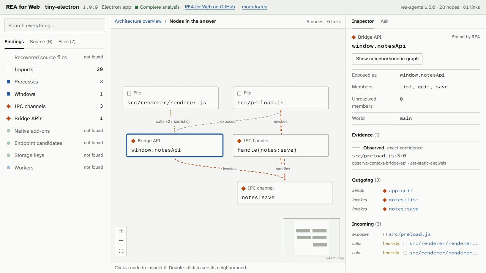
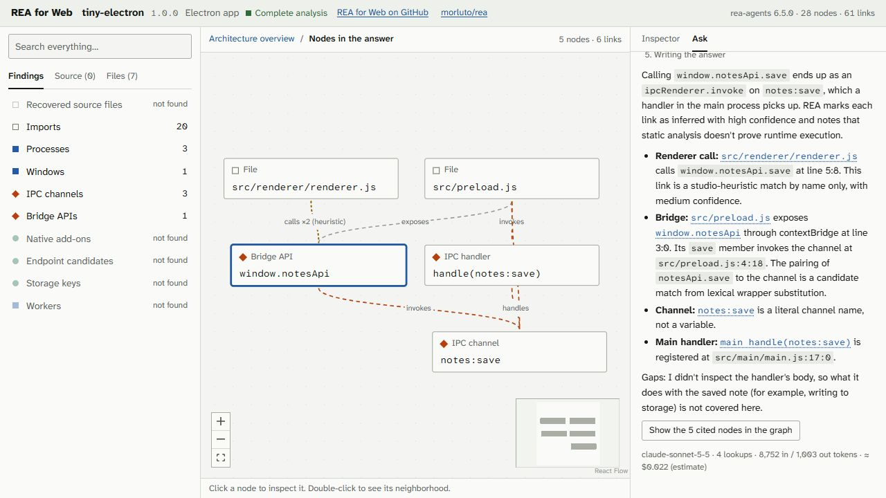

# REA for Web

**Upload an app. Explore how it works. Ask questions with evidence.**

[Open the website](https://reaforweb.com) · [Upload an app](https://uploads.reaforweb.com/upload) · [Try a demo](https://reaforweb.com/explore/tiny-electron) · [Upstream REA](https://github.com/morluto/rea)

REA for Web turns application files into an interactive map you can explore in
your browser. Follow an Electron app's IPC messages, inspect an Android app's
components, or trace a native program's function calls. Select a node to see
where a finding came from, then ask a question about the connections.

Built on [morluto/rea](https://github.com/morluto/rea), the reverse-engineering
engine behind the analysis. The analyzer runs **REA 6.7.0**.



*A real upload of the included Tiny Electron sample. The inspector separates
observed evidence from inferred connections and Studio heuristics.*

## Try it

1. **[Upload an application file](https://uploads.reaforweb.com/upload).** No account or access key required. Choose a supported file below and wait for its analysis.
2. **Explore the map.** Search for a component, click to inspect its evidence, or double-click to follow its connections.
3. **Open Ask.** Ask how a feature works and follow the answer's citations back into the graph.

Prefer to look around first? Try [GitHub Desktop](https://reaforweb.com/explore/github-desktop),
[VS Code's core](https://reaforweb.com/explore/vscode-core),
[Caprine](https://reaforweb.com/explore/caprine),
[jq for Windows](https://reaforweb.com/explore/jq),
[jq for macOS](https://reaforweb.com/explore/jq-macos), or
[Binary Eye for Android](https://reaforweb.com/explore/binary-eye).
These are pre-analyzed samples; some intentionally cover a subset of the app.
Their explorer headers retain the REA version used to collect them.

## Supported targets

| Target | Public upload | What you can explore |
| --- | --- | --- |
| **Electron / JavaScript** | `.asar` | Main, preload and renderer processes; windows; bridge APIs; IPC channels and handlers; imports; source-map files where available. |
| **.NET** | `.exe`, `.dll` | Assemblies, types, methods, calls and native interop declarations. |
| **Native Windows** | `.exe`, `.dll` | Functions, call relationships, imports and referenced strings, using Ghidra. |
| **Android** | `.apk` | Manifest components, permissions, collected classes and methods, references, and labeled heuristics for bridges, storage and endpoints, using JADX. |
| **Linux** | `.elf`, `.so` | Native functions, calls, imports and referenced strings, using Ghidra. |
| **macOS** | `.macho`, `.dylib` | Single-architecture Mach-O functions, calls and imports, using Ghidra. Full real-world verification currently covers x86_64 jq. |
| **Websites** | Local CLI only: `https://…` | Captured page scripts, framework/bundler fingerprints, routes and endpoint candidates. |

Upload the application's program file, rather than a generic installer or archive.
For Electron, this is usually `resources/app.asar` inside an installed or extracted
app. Rename extensionless Linux programs to `.elf`, and thin macOS programs to
`.macho`; the analyzer also checks the actual file format.

Universal macOS binaries, whole `.app` bundles, `.ipa`, `.dmg` and generic `.zip`
uploads are not supported. The local CLI additionally accepts extracted
Electron/JavaScript directories. Program files are analyzed statically, without
executing them; local website capture loads the requested page in a fresh Chrome
profile.

## Follow the evidence

- **Connected views:** start with the overview, search by name or file, then follow a node's neighborhood.
- **Inspectable findings:** nodes and links carry locations, observed/inferred state, categorical confidence and analysis limitations.
- **Source-map recovery:** browse original source files when an app ships source maps, separately from its shipped files and bundled modules.
- **Visible gaps:** partial coverage and unresolved facts stay visible. “Not found” does not establish absence.
- **Labeled heuristics:** Studio's additional bridge links and endpoint assessments are distinguished from REA's findings. Unlikely endpoint candidates are hidden by default but remain available.

## Ask questions about the map

Ask searches the current analysis, reads evidence and follows relationships before
answering. Citations select the corresponding nodes; the graph can show the parts
used in the answer.

For example, on Tiny Electron:

> What happens when the renderer calls `window.notesApi.save`? Trace the bridge,
> IPC channel and main-process handler.



*An actual Ask response on the uploaded sample, with five cited nodes. The answer
identifies inferred links and explicitly leaves uninspected behavior unresolved.*

- **Free Ask:** Llama 3.3 70B for demos and local project files opened on `reaforweb.com`, with usage limits and no API key required. The separate upload host currently requires your own Anthropic key for questions; uploading and exploring need no key.
- **Use Claude:** optionally supply your own Anthropic API key in Ask. Requests go directly from your browser to Anthropic. The UI shows token usage and an estimated API cost; API billing is separate from a Claude chat subscription. Keys are kept in the browser session unless you choose “Remember on this device,” and can be removed with “Forget key.”
- **Use an MCP client:** connect to `https://reaforweb.com/api/mcp` for the public demos, or run the local MCP server over your own project files. See the [MCP guide](docs/mcp.md).

Asking a question sends your question and the analysis context the model reads
to the selected provider. Free Ask routes through the site and Cloudflare;
Claude requests go to Anthropic. Model answers can be wrong: use the citations
and evidence inspector to check them.

## Upload limits and privacy

Public uploads accept files up to **512 MiB**. Initial admission limits are
**3 uploads per network per UTC day**, **25 site-wide per day** and **500 per
UTC month**. Limits count issued upload tickets, including attempts that later
fail. Queue capacity and disk-space guards
can temporarily pause admission. Analyses run one at a time, and large apps
can take many minutes. The job page shows queue and analyzer progress.

Uploaded programs are processed in containers with no network, a non-root user,
a read-only root filesystem, and CPU, memory, time and output limits. Raw uploads
are removed after processing, with expiry cleanup for abandoned uploads. Results
are stored privately on the analysis server and accessed with a token held in
your browser session. Copying a private job URL alone does not share its result
with someone else; losing that session can also lose access.

For files you want to keep on your own machine, use local analysis below. The
`.studio.json` viewer reads the project file in your browser; choosing Ask still
sends the relevant analysis context to its provider.

## Analyze locally

Use **Node.js 22.19+ (22.x), 24.11+ (24.x), or 26+**, and **npm 10+**.
From a terminal:

```sh
git clone https://github.com/sulaimwn/REA-For-Web.git
cd REA-For-Web
npm ci --ignore-scripts

npm run analyze --workspace=rea-studio -- "path/to/app.asar" --out my-app.studio.json
```

Open [reaforweb.com/open](https://reaforweb.com/open) and drop in
`my-app.studio.json`. The analysis and project-file loading happen on your
machine. To use a local viewer too, run `npm run dev` and open
[localhost:3000/open](http://localhost:3000/open).

Electron and .NET analysis use the bundled REA package. Other local targets need
additional tools:

| Target | Local requirement |
| --- | --- |
| Native Windows | Ghidra and JDK 21; set `GHIDRA_INSTALL_DIR`. |
| Linux / macOS programs | Ghidra and JDK 21 on Linux or macOS; set `GHIDRA_INSTALL_DIR`. |
| Android | JADX headless MCP 0.7.1 JAR and a full JDK 17+ (not a JRE); set `REA_JADX_MCP_JAR`. |
| Website URL | An installed Chrome browser; the CLI creates a temporary profile. |

Local analysis runs with your user account's permissions. For containerized
analysis, use the Docker upload stack described below. See the [CLI](apps/cli/README.md)
and [target/provider notes](docs/targets.md) for options and setup details.

## Run and develop

After installing dependencies from the repository root:

```sh
npm run dev                         # web app: http://localhost:3000
npm run typecheck
npm test --workspaces --if-present
npm run build
npm start                           # serve the production build
```

The web app rebuilds its demo projects from committed fixtures before development
and production builds. After editing a shared package while the dev server is
running, refresh its output with `npm run build:packages`.

To run **uploads, Redis and the sandbox worker** locally, start Docker and run:

```sh
npm run dev:uploads
```

Open [localhost:3104/upload](http://localhost:3104/upload). The first run builds
both analysis images, including Ghidra and JADX, and can take a while. Native
Linux hosts require the documented service-account setup. See the
[upload setup and integration checks](docs/uploads.md).

## How it works

```text
Application file → private upload → queue → sandboxed REA analysis
                                                    ↓
                                              REA evidence
                                                    ↓
                                                adapter
                                                    ↓
                                             StudioProject
                                                    ↓
                                            explorer + Ask
```

The main website runs on Cloudflare Workers. Public file uploads are handled by
a separate Linux service with private disk storage and a Docker analysis worker.
Local CLI output enters the same explorer through `/open`.

| Location | Responsibility |
| --- | --- |
| [`apps/web`](apps/web) | Next.js / React explorer, React Flow graph, upload UI and Ask panel. |
| [`apps/worker`](apps/worker/README.md) | Sandboxed REA runner and queue consumer. |
| [`apps/cli`](apps/cli) | Local analysis to `.studio.json`. |
| [`packages/schema`](packages/schema/src/index.ts) | Shared `StudioProject` types. |
| [`packages/rea-adapter`](packages/rea-adapter) | Converts raw REA output into the explorer's evidence model. |
| [`packages/pipeline`](packages/pipeline) | Upload admission, private storage, queueing and cache. |
| [`packages/ask`](packages/ask) | Graph lookup tools and model orchestration. |
| [`packages/mcp`](packages/mcp) | Read-only MCP access to analyzed projects. |

Only the adapter consumes raw REA output. The website, worker result and Ask
tools share the normalized project format. See [architecture](ARCHITECTURE.md),
[fixtures and coverage](fixtures/README.md), [Cloudflare deployment](docs/deploy-cloudflare.md)
and [public upload hosting](docs/public-disk-uploads.md).

## Current limitations

Analysis coverage depends on the target. Dynamic IPC names, obfuscation, stripped
symbols and missing source maps can leave parts unresolved. Collection budgets
and timeouts can produce partial maps; per-file recovery improves large
JavaScript maps within those budgets. Native views show collected functions and
relationships, rather than a complete recovered source codebase. The graph is
not a complete runtime dataflow model.

REA 6.7.0 supports more capabilities than this website currently exposes.
Upstream support for a format or tool does not automatically make it available
through public uploads. The supported-target table above describes this project.

## Contributing

Bug reports and improvements are welcome in
[GitHub issues](https://github.com/sulaimwn/REA-For-Web/issues). For analysis bugs,
include the target format, displayed engine version, last progress/error message
and a reproducible public sample where possible. Keep credentials and private
application data out of reports. Agent contributors should read [AGENTS.md](AGENTS.md).

## Credits and license

[REA by morluto](https://github.com/morluto/rea) powers the analysis. REA for Web
is an independent browser interface and upload service built on top of it.

Public demo data includes [GitHub Desktop](https://github.com/desktop/desktop),
[Code - OSS / VS Code core](https://github.com/microsoft/vscode),
[Caprine](https://github.com/sindresorhus/caprine), [jq](https://github.com/jqlang/jq)
and [Binary Eye](https://github.com/markusfisch/BinaryEye), alongside small
hand-written samples with answer keys. See [sample sources and licenses](fixtures/sample-apps/real-world.md)
for releases, provenance and coverage.

This repository is licensed under [MIT](LICENSE). Upstream tools and analyzed
applications retain their own licenses.
