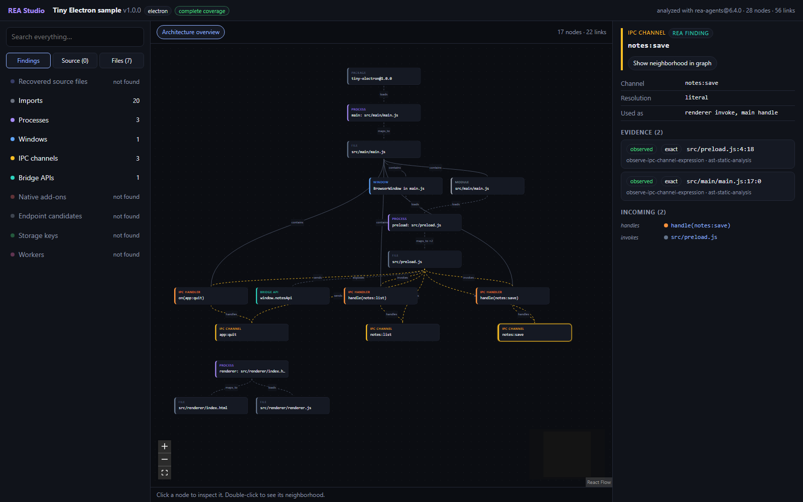
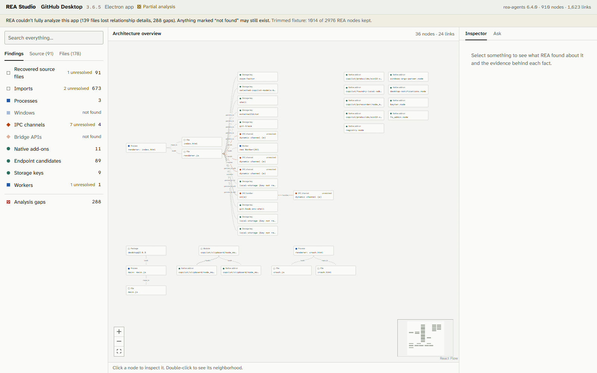
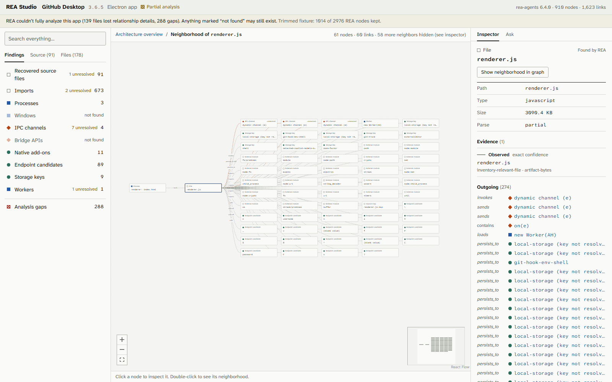

# REA for Web

**Explore apps, visualize their architecture, and ask AI how they work.**

[Try it at reaforweb.com](https://reaforweb.com)

REA for Web (REA Studio) brings [REA](https://github.com/morluto/rea) analysis
into an interactive browser explorer. Follow connections through an app, inspect
the evidence behind each finding, and ask questions about how its features work.

Supports Electron apps, .NET assemblies, native Windows/Linux programs, Android
APKs, and website captures. Findings vary by target: processes and IPC channels,
types and calls, native functions and imports, Android components and permissions,
or website scripts and frameworks.

## Try it

- **Explore a demo:** open the [website](https://reaforweb.com) and choose a sample or real app, including GitHub Desktop, VS Code, Caprine, jq, and Binary Eye.
- **Explore your own app:** analyze it locally, then open the resulting `.studio.json` at [reaforweb.com/open](https://reaforweb.com/open). The project file is read in your browser.
- **Ask a question:** open the explorer's Ask tab and supply your own Anthropic API key. Free Ask is not enabled on the current public release.

The website is live. **Hosted app uploads are not available yet**; the upload
pipeline works locally, and the separate analysis host is still pending setup.
See [local upload setup](docs/uploads.md) and [hosted deployment](docs/hosted-uploads.md).

Program files are analyzed without executing them. Website capture loads the
requested page in a fresh browser. This is an independent project built on REA.



## What you can explore

| | |
|---|---|
| **Architecture overview** | Main, preload and renderer processes, windows, `contextBridge` APIs, IPC channels and handlers, native `.node` add-ons, storage keys and workers, laid out as a graph. |
| **Evidence inspector** | Every node and link carries REA's evidence: location, observed vs. inferred, REA's confidence category, the extractor that produced it, and REA's own limitations. |
| **Recovered source tree** | Original files such as `app/src/ui/history/compare.tsx`, recovered from shipped source maps. |
| **Neighborhoods** | Double-click any node to see everything connected to it. |
| **Honest gaps** | Partial coverage, unresolved IPC channel names and files REA couldn't fully analyze are shown, not hidden. "Not found" never means "doesn't exist." |
| **Shareable links** | The URL records the selected node and view. |

### A real app: GitHub Desktop



GitHub Desktop is a large, webpack-bundled app, and the demo shows what static
analysis can and can't recover from it. REA finds the processes, native
add-ons, storage keys and 1,777 original source files (the demo uses a trimmed
sample of the output). But GitHub Desktop passes IPC channel names as
variables, so they're marked **unresolved** rather than guessed.



## Ask questions about an app

Open the **Ask** tab in the explorer and ask in plain English, e.g. *"How does the
app save notes?"* Claude looks things up in the analysis (search, follow links,
trace paths), answers with every node linked to the graph, and the graph switches
to show exactly the nodes the answer used. It says when something is unresolved
instead of guessing.

It uses **your own Anthropic API key**, sent only from your browser to
api.anthropic.com, and each answer shows its token cost. The same analysis tools are available through the MCP connector; see
[MCP setup](docs/mcp.md).

## Explore your own app (local mode)

Analyze an app on your machine and open the result in the browser. Nothing is uploaded.

```sh
npm install
npm run analyze -w rea-studio -- path/to/YourApp/resources/app.asar   # writes app.studio.json
npm run dev                                                             # then open http://localhost:3000/open
```

Drop the `.studio.json` file on the **/open** page. Your browser reads it
locally. REA only reads the app's files and never runs it. See
[apps/cli](apps/cli/README.md) for options and timings.
## VS Code's core demo

The VS Code demo covers its main process and preload scripts: 3 BrowserWindows,
4 `contextBridge` APIs, and 18 named IPC channels (`vscode:fetchShellEnv`,
`vscode:browserView:*`). VS Code's main-process handlers register channels
through a validating wrapper, so REA reports them as unresolved instead of
pairing them.

## How it works

```
app / program / APK ──► target-specific REA analysis ──► REA evidence JSON
                                                                     │
                                            @rea-studio/rea-adapter  ▼
                                                              StudioProject JSON ──► web explorer
```

- **[`packages/schema`](packages/schema/src/index.ts)** defines `StudioProject`, the format
  the UI reads. It's derived from real REA 6.4.0 output: categorical confidence, evidence on
  everything, and explicit gaps.
- **[`packages/rea-adapter`](packages/rea-adapter/src/index.ts)** is the only code that reads
  raw REA output. On GitHub Desktop it turns 50 MB of REA JSON into 4.5 MB in under half a second.
- **[`apps/web`](apps/web)** is the Next.js explorer (React Flow + dagre). The demo pages are
  static HTML.
- **[`apps/cli`](apps/cli/README.md)** (local mode) runs REA and the adapter on your machine
  and writes a `.studio.json` file that the web app's `/open` page reads in the browser.
- **[`apps/worker`](apps/worker)** runs REA in a locked-down container (no network, non-root,
  resource limits) and normalizes the result with the adapter. It's verified locally with Docker
  but not deployed yet; see [its README](apps/worker/README.md).

See [ARCHITECTURE.md](ARCHITECTURE.md) for the full design and
[fixtures/README.md](fixtures/README.md) for what REA's output actually contains,
including measurements and known limitations.

## Status

The public preview is live at [reaforweb.com](https://reaforweb.com). It shows **pre-analyzed open-source apps**, and
local mode lets you analyze and view an app entirely on your own machine.
Uploading your own app is available locally with `npm run dev:uploads`.
Choose an `.asar`, `.exe`, `.dll`, `.apk`, `.elf` or `.so` file. Linux programs
without an extension should be renamed to `.elf` before uploading.
The full upload → queue → Docker analysis → explorer flow is tested with public fixtures for all five analysis kinds,
including Ghidra and JADX analysis. The helper builds both worker images by
default. Cloudflare R2 and the hosted analysis backend are not connected yet.
See [upload setup and API](docs/uploads.md).

Known limitations (from REA 6.4.0, documented in [fixtures/README.md](fixtures/README.md)):
- Electron APIs reached through webpack's module aliases (e.g. `r.BrowserWindow`) aren't recognized,
  so windows and handlers in bundled apps are often "not found."
- IPC channels passed as variables can't be named statically.
- REA's endpoint detection is noisy; Studio filters unlikely candidates by default
  and labels that decision as a heuristic. All candidates remain available.
- In whole-app runs, REA's shared result budget can drop relationship detail.
  Per-file recovery restores affected relationships within the job's time budget.
- Ghidra/JADX analysis has collection and resource caps. Missing method bodies
  and other unresolved facts remain visible as partial coverage.

## Development

Use Node.js 22.19+ on the 22.x line, 24.11+ on the 24.x line, or 26+, and npm
10+. Install dependencies once from the repository root:

```sh
npm install
npm run typecheck
npm run build
```

The committed `package-lock.json` pins the dependency tree. Use `npm ci` for
repeatable installs in CI or a fresh checkout.

Start the web app at http://localhost:3000:

```sh
npm run dev
```

`npm run dev` and `npm run build` regenerate the demo data in
`apps/web/public/projects/` from the committed fixtures. To serve a production
build locally, run `npm run build` followed by `npm start`.

| Workspace | Purpose |
| --- | --- |
| `@rea-studio/web` | Next.js explorer and demo pages |
| `@rea-studio/schema` | `StudioProject` types, derived from real REA fixtures |
| `@rea-studio/rea-adapter` | REA JSON → `StudioProject`, with fixture tests (`npm test -w @rea-studio/rea-adapter`) |
| `@rea-studio/worker` | Sandboxed REA runner that outputs `StudioProject` (Docker; see `apps/worker/README.md`) |
| `rea-studio` | Local-mode CLI (`apps/cli`): REA + adapter on your machine → `.studio.json`; tests: `npm test -w rea-studio` |

All workspaces extend `tsconfig.base.json`. Root builds run schema, adapter,
worker and web in dependency order. After changing a shared package while
`npm run dev` is running, run `npm run build:packages` to refresh its output.

### Deployment

The demos, local-file viewer and Ask panel deploy to Cloudflare Workers. See
[the deployment guide](docs/deploy-cloudflare.md) for GitHub Actions setup and
custom-domain configuration. Hosted app uploads need a separate analysis
backend. Ask uses each visitor's own Anthropic API key.

## Credits

- [REA](https://github.com/morluto/rea) (MIT) does the analysis.
- Demo data comes from [GitHub Desktop](https://github.com/desktop/desktop) (MIT) 3.6.5, a core subset of the
  VS Code 1.141.0 build ([Code - OSS](https://github.com/microsoft/vscode) source is MIT), and a hand-written sample app.

## License

[MIT](LICENSE).
